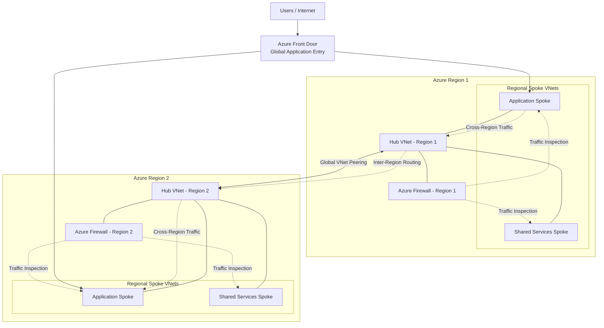

# Architecture Design — Multi-Region Hub-and-Spoke Network

## 1. Architecture Overview

This architecture represents an enterprise-style Azure network distributed across two Azure regions.

Each region contains a centralized Hub Virtual Network connected to multiple Spoke Virtual Networks. Azure Firewall is deployed within each regional Hub to provide centralized network security, traffic inspection, and controlled connectivity.

The regional Hub Virtual Networks are interconnected through Global VNet Peering to support private inter-region communication.

The architecture incorporates centralized routing, network segmentation, security enforcement, monitoring, global application connectivity, and resiliency considerations.

The primary objectives are:

- Regional network isolation
- Centralized network security
- Controlled inter-region communication
- Centralized routing and traffic inspection
- Network segmentation
- Application availability across regions
- Network resiliency and failover
- Enterprise network troubleshooting

---

## 2. High-Level Architecture

> The diagram represents the network topology and intended connectivity relationships. Actual traffic paths are determined by VNet peering configuration, User Defined Routes, firewall policies, and applicable network security rules.

---

## 3. Regional Architecture

### Region 1

Region 1 contains the primary regional network infrastructure:

- Hub Virtual Network
- Azure Firewall
- Azure Firewall subnet
- Firewall management subnet where required
- Application Spoke Virtual Network
- Shared Services Spoke Virtual Network
- Route Tables
- Network Security Groups
- Workload Virtual Machines
- Centralized network connectivity

### Region 2

Region 2 contains a similar network architecture:

- Hub Virtual Network
- Azure Firewall
- Azure Firewall subnet
- Application Spoke Virtual Network
- Shared Services Spoke Virtual Network
- Route Tables
- Network Security Groups
- Workload Virtual Machines
- Centralized network connectivity

Each region operates within a separate IP address space to support network isolation and avoid address conflicts.

The regional architecture allows workloads to operate independently while providing controlled connectivity between regions.

---

## 4. Hub-and-Spoke Architecture

The Hub Virtual Network acts as the centralized networking layer for its region.

Spoke Virtual Networks host application workloads and shared services while relying on the Hub for centralized network connectivity and security services.

The architecture provides:

- Centralized network security
- Network segmentation
- Controlled workload connectivity
- Centralized routing
- Shared networking services
- Consistent security enforcement
- Simplified network administration

Spoke-to-spoke and inter-region connectivity is controlled through routing configuration, firewall policies, and Network Security Groups.

VNet peering provides connectivity between the Hub and Spoke networks. However, peering alone does not force traffic through Azure Firewall.

Traffic inspection is achieved through explicit routing configuration, including User Defined Routes where required.

---

## 5. Inter-Region Connectivity

The regional Hub Virtual Networks are connected using Global VNet Peering.

Global VNet Peering provides private connectivity between Virtual Networks located in different Azure regions.

The architecture uses inter-region connectivity to support:

- Communication between regional workloads
- Shared services access across regions
- Cross-region network management
- Controlled inter-region traffic
- Regional resiliency scenarios
- Network troubleshooting

Global VNet Peering does not provide transitive routing.

Therefore, connectivity between Spoke Virtual Networks in different regions requires an explicitly designed routing path.

Inter-region traffic inspection is implemented through routing configuration and Azure Firewall policies.

The routing design must account for:

- VNet peering configuration
- User Defined Routes
- Firewall forwarding behavior
- Next-hop selection
- Return traffic routing
- Network Security Group rules
- Asymmetric routing prevention

---

## 6. Centralized Security Architecture

Azure Firewall is deployed in each regional Hub Virtual Network.

Each regional Firewall provides centralized security enforcement for traffic routed through the Hub.

Security controls include:

- Network rules
- Application rules
- Firewall policies
- Threat intelligence
- Controlled outbound connectivity
- Traffic inspection
- Firewall logging
- Inter-region traffic control

Network Security Groups provide additional security at the subnet and network-interface level.

The architecture follows a layered security approach:

1. Azure Firewall provides centralized traffic inspection and enforcement.
2. Network Security Groups control traffic at the subnet or network-interface level.
3. User Defined Routes control traffic paths and next-hop selection.
4. Application security controls protect application-specific traffic.
5. Monitoring and logging provide visibility into network activity.

Firewall inspection is applied to traffic flows through the Firewall according to the routing configuration.

---

## 7. Routing Architecture

Routing is controlled through a combination of Azure system routes, User Defined Routes, VNet Peering, and Azure Firewall.

The routing architecture incorporates:

- Azure system routes
- User Defined Routes
- VNet Peering
- Firewall next-hop routing
- Route tables
- Effective route analysis
- Next-hop validation
- Return-path analysis

The architecture supports investigation of routing between:

- Spoke and Hub
- Application and Shared Services Spokes
- Regional workloads
- Region 1 and Region 2
- Workloads and the Internet
- Workloads and centralized services

### Routing Principles

- Centralized traffic inspection
- Explicit routing paths
- Controlled inter-region communication
- Regional traffic preference
- Return-path awareness
- Route-selection verification
- Failover behavior designed separately from normal routing

Azure User Defined Routes are static routes.

Therefore, route failover is not assumed to occur automatically when a Firewall or network path becomes unavailable.

Network failover behavior must use an explicitly designed mechanism such as manual route modification, automation, or dynamic routing where supported by the architecture.

---

## 8. Global Application Connectivity

Azure Front Door provides the global application entry point.

It enables application-layer traffic distribution across application endpoints deployed in both Azure regions.

The architecture uses Azure Front Door to investigate:

- Global application entry
- Application-layer routing
- Health probes
- Backend health monitoring
- Regional traffic distribution
- Regional application failover
- Application availability

Application availability and network connectivity are treated as separate design considerations.

Azure Front Door can redirect application traffic based on backend health, but this does not automatically provide failover for private network routes, VNet connectivity, Firewall paths, or UDRs.

The backend connectivity and origin security configuration must ensure that application workloads are not exposed unnecessarily and that traffic reaches the intended application endpoints.

---

## 9. Monitoring and Diagnostics

The architecture incorporates Azure-native monitoring and troubleshooting services to provide visibility into network activity and connectivity.

### Monitoring Services

- Azure Monitor
- Log Analytics Workspace
- Network Watcher
- Azure Firewall Logs
- Network Security Group diagnostics

### Network Troubleshooting Tools

- Effective Routes
- Next Hop
- IP Flow Verify
- Connection Troubleshoot
- Packet Capture
- Network Watcher connectivity diagnostics

These tools are used to investigate:

- Routing failures
- Network Security Group restrictions
- Firewall policy blocks
- VNet Peering issues
- DNS resolution problems
- Connectivity failures
- Unexpected next-hop selection
- Asymmetric routing
- Regional connectivity issues

Azure Firewall logs are integrated with centralized monitoring to support traffic analysis, security investigations, and troubleshooting.

---

## 10. Failure Scenarios

The architecture supports investigation of the following failure scenarios.

| Scenario | Investigation Focus |
|---|---|
| Regional Firewall unavailable | Connectivity impact and alternate routing behavior |
| Incorrect UDR | Route selection and next-hop verification |
| NSG blocking traffic | Identify the security rule causing the failure |
| Firewall blocking traffic | Review Firewall policy and logs |
| Global VNet Peering failure | Investigate inter-region connectivity |
| Application in Region 1 unhealthy | Validate Azure Front Door application failover |
| Incorrect return route | Investigate asymmetric routing |
| Backup route unavailable | Analyze resiliency and route behavior |
| DNS failure | Investigate name resolution and DNS configuration |
| Network path failure | Use Network Watcher diagnostic tools |
| Regional workload failure | Validate application availability and recovery behavior |

Failure testing focuses on understanding the actual network behavior, identifying the failure point, and validating the recovery mechanism.

---

## 11. Architecture Validation

The architecture is validated through implementation and controlled testing.

The validation process includes:

- Confirming that network address spaces do not overlap
- Verifying VNet Peering configuration
- Confirming required network connectivity
- Validating routing paths
- Verifying Firewall traffic inspection
- Testing Network Security Group enforcement
- Validating application connectivity
- Testing inter-region communication
- Measuring failover behavior
- Confirming monitoring and logging functionality
- Reproducing and troubleshooting network failures
- Documenting test results and recovery behavior
- Documenting resource cleanup procedures

Architecture validation includes both normal network operation and failure scenarios.

---

## 12. Architecture Design Principles

The network architecture follows these principles:

- **Network segmentation:** Workloads are separated into dedicated Spoke Virtual Networks.
- **Centralized security:** Azure Firewall provides centralized traffic inspection.
- **Explicit routing:** Traffic paths are controlled through routing configuration.
- **Regional isolation:** Each Azure region maintains its own network infrastructure.
- **Controlled inter-region connectivity:** Cross-region communication uses explicitly designed routing paths.
- **Layered security:** Firewall policies, NSGs, and routing controls operate together.
- **Resiliency:** Application availability and network failover are designed and evaluated separately.
- **Observability:** Azure-native monitoring and diagnostic tools provide visibility into network behavior.
- **Troubleshooting:** Network failures are investigated using route analysis, connectivity diagnostics, logs, and packet-level tools.

---

## 13. Architecture Summary

The multi-region Hub-and-Spoke architecture provides a structured enterprise networking environment across two Azure regions.

Each region contains a Hub Virtual Network with Azure Firewall and multiple Spoke Virtual Networks hosting application and shared services workloads.

Global VNet Peering connects the regional Hub networks, while routing configuration controls traffic between Spokes, regions, and centralized network services.

Azure Front Door provides global application connectivity, while Azure Firewall, Network Security Groups, User Defined Routes, Azure Monitor, and Network Watcher support security enforcement, routing control, monitoring, and troubleshooting.

The architecture provides a foundation for investigating enterprise Azure networking concepts including centralized security, inter-region routing, resiliency, failover, and network troubleshooting.
